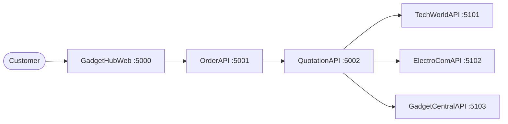

# GadgetHub

A service-oriented order management system for an electronics retailer that holds no inventory of its own. Customers place an order, and the system asks three distributors (TechWorld, ElectroCom and Gadget Central) for quotes, then picks the best option for each product, splitting the order across distributors when no single one has enough stock.

Built with ASP.NET Core as coursework for a Higher Diploma in Computing and Software Engineering (Service-Oriented Computing).

## How it works

1. A customer registers, logs in and places an order in **GadgetHubWeb**, which sends it to **OrderAPI**.
2. **OrderAPI** asks **QuotationAPI** to gather quotes for the order.
3. **QuotationAPI** calls all three distributor APIs in parallel (`Task.WhenAll`) and saves each quote.
4. For every product, it chooses the distributor that can supply the full quantity first, then the lowest unit price, then the fastest delivery. If no single distributor has enough stock, the quantity is split across several.
5. The resulting distribution plan is saved and returned. Distributor staff review and confirm quotations through their portals, and confirmed orders are passed on to the relevant distributor APIs.

## Projects

| Project | Port | Role |
| --- | --- | --- |
| `GadgetHubWeb` | 5000 | Customer-facing web app: register, log in, place orders, track orders |
| `OrderAPI` | 5001 | Central API for customers, products, orders, and distributor and admin logins |
| `QuotationAPI` | 5002 | Requests quotes from distributors, splits orders, stores quotations and distribution plans |
| `TechWorldAPI` | 5101 | Distributor service with its own inventory database |
| `ElectroComAPI` | 5102 | Distributor service with its own inventory database |
| `GadgetCentralAPI` | 5103 | Distributor service with its own inventory database |
| `DistributorPortal` | 5200 | Staff portal for distributors: login, dashboard, quotations |
| `TechWorldPortal` | 5201 | Staff portal specific to TechWorld |
| `AdminPortal` | 5300 | Admin login and dashboard |

`ElectroComPortal` and `GadgetCentralPortal` are placeholder projects created from the default template and are not used.

## Tech stack

- **Backend:** C#, ASP.NET Core Web API, Entity Framework Core, SQL Server Express, REST over HTTP with JSON
- **Frontend:** ASP.NET Core MVC with Razor views, HTML, CSS, JavaScript, Bootstrap, jQuery
- **Tools:** Visual Studio, .NET 8 / .NET 9

## Running locally

**Requirements:** Visual Studio 2022 or later, the .NET SDKs the projects target (8 and 9), and SQL Server Express running as `localhost\SQLEXPRESS`.

1. Set up the databases by running `database/setup.sql` (see the Database section below).
2. Open `GadgetHub.sln` in Visual Studio.
3. Set multiple startup projects: `OrderAPI`, `QuotationAPI`, `TechWorldAPI`, `ElectroComAPI`, `GadgetCentralAPI` and `GadgetHubWeb`, plus any portals you want to try.
4. Start the solution and open http://localhost:5000.

Each project can also be started on its own with `dotnet run --project <ProjectName>`.

## Database

The services connect with Windows authentication to these databases on `localhost\SQLEXPRESS`:

| Database | Used by |
| --- | --- |
| `GadgetHubDB` | OrderAPI and QuotationAPI |
| `TechWorldDB` | TechWorldAPI |
| `ElectroComDB` | ElectroComAPI |
| `GadgetCentralDB` | GadgetCentralAPI |

Run the setup script once to create all four databases with their tables and data. It is safe to re-run, because existing databases, tables and rows are skipped.

- **SQL Server Management Studio:** connect to `localhost\SQLEXPRESS`, open `database/setup.sql` and click Execute.
- **Terminal:** `sqlcmd -S localhost\SQLEXPRESS -E -i database\setup.sql`

The tables mirror the entity classes in each project's `Models` folder. The script loads the 150-product catalogue, each distributor's own prices and stock levels, and the admin and distributor staff accounts. Customers and orders are not included: register a customer on the site and place an order to try the full flow.

| Portal | Username | Password |
| --- | --- | --- |
| Admin portal | `admin` | `admin123` |
| TechWorld staff | `techworld` | `tech123` |
| ElectroCom staff | `electrocom` | `electro123` |
| Gadget Central staff | `gadgetcentral` | `gadget123` |

## Known limitations

- Passwords are stored and compared as plain text. A production version should hash them (for example with BCrypt or ASP.NET Core Identity).
- Connection strings and service URLs are hardcoded rather than read from configuration or environment variables.
- Demo logins are shown on the portal login pages for demonstration purposes.
- Order-splitting logic lives directly in a controller and would be better extracted into a service.
- There are no automated tests and no EF Core migrations.
